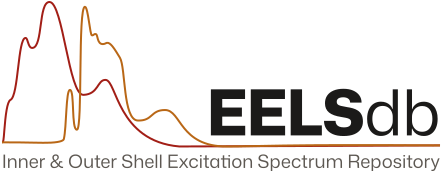

<picture>
  <source media="(prefers-color-scheme: dark)" srcset="worker/public/logo/eelsdb-logo-dark-bg.svg">
  
</picture>

# [EELS Data Base](https://eelsdb.eu) website code

The EELS Data Base is a free, public collection of electron energy-loss (EELS) and X-ray absorption (XAS) spectra. Microscopists and spectroscopists use it to find reference spectra, compare them with their own measurements, and download and cite them. It has run at [eelsdb.eu](https://eelsdb.eu) since 2014, and in earlier forms since about 2005.

Researchers share their spectra through a web form. Moderators check each submission before it goes public. Each spectrum records its acquisition details, a paper to cite where there is one, and an open licence (ODbL 1.0 for most data).

The site has:

- a browse page with filters for elements, edges, energy range and resolution, and a page for each spectrum with an interactive plot
- downloads in MSA, CSV, JSON and HyperSpy (HSPY) formats, plus a bulk download of everything
- a JSON API at [api.eelsdb.eu](https://api.eelsdb.eu), which [exSpy](https://github.com/hyperspy/exspy) uses to load spectra into HyperSpy
- metadata feeds (OAI-PMH, DCAT-AP and schema.org) for data catalogues and search engines

This repository holds the code for the website and the API. It runs on Cloudflare Workers.

## Contributing

See [`CONTRIBUTING.md`](CONTRIBUTING.md) for how to set up, test and change the code. The [architecture decision records](docs/adr/) explain why the site works the way it does.

## Citation

If you use EELSdb in your research, please consider citing the main paper:

> _“A Complete Overhaul of the Electron Energy-Loss Spectroscopy and X-Ray Absorption Spectroscopy Database: eelsdb.eu.”_
>
> Philip Ewels, Thierry Sikora, Virginie Serin, Chris P. Ewels and Luc Lajaunie.
>
> Microscopy and Microanalysis, 22, 717–724 (2016)
>
> doi: [10.1017/S1431927616000179](http://dx.doi.org/10.1017/S1431927616000179)
